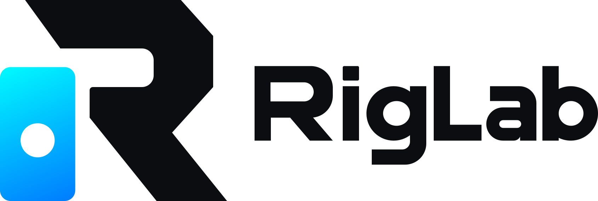

  <picture>
    <source media="(prefers-color-scheme: dark)" srcset="assets/riglab-wordmark-on-dark.svg">
    
  </picture>

  Procesador de efectos para guitarra: pedales, amplis (incluidas capturas
  <a href="https://www.tone3000.com">NAM</a>), gabinetes con IRs, looper y modo pedalera.

  

Este repositorio solo publica las versiones compiladas. Descárgalas en
**[Releases](../../releases/latest)**.

## Instalar

| Sistema | Archivo |
|---|---|
| Mac con Apple Silicon (M1, M2…) | `RigLab_x.y.z_aarch64.dmg` |
| Mac con Intel | `RigLab_x.y.z_x64.dmg` |
| Windows 10/11 | `RigLab_x.y.z_x64-setup.exe` |
| Linux | `RigLab_x.y.z_amd64.AppImage` |

La app no está firmada por Apple ni Microsoft, así que la primera vez
aparece un aviso:

- **Mac:** abre el `.dmg` y arrastra RigLab a Aplicaciones. Luego clic
  derecho sobre RigLab → **Abrir** → **Abrir**. Si dice que la app está
  dañada, ejecuta en Terminal:
  `xattr -dr com.apple.quarantine /Applications/RigLab.app`.
  Al abrirla, acepta el acceso al micrófono para que entre la guitarra.
- **Windows:** ejecuta el `setup.exe`. Si sale "Windows protegió su PC",
  elige **Más información** → **Ejecutar de todas formas**. En
  Configuración → Privacidad → Micrófono, deja activado "Permitir que las
  aplicaciones de escritorio accedan al micrófono".
- **Linux:** dale permiso de ejecución al AppImage y ábrelo.

## Actualizaciones

RigLab revisa si hay versión nueva al abrirse y cada pocas horas. La
descarga sola y te avisa con **Restart**; nunca se reinicia mientras
tocas.

## Licencia

© Daniel Anchondo. Todos los derechos reservados. Las licencias de las
bibliotecas de terceros que incluye están en RigLab → **About RigLab**.
